# Agente de recepción de pedidos y planillas de producción (n8n + RAG)

Proyecto final del curso de Automatización con IA. Sistema construido en **n8n** que recibe los pedidos diarios de los clientes de un centro de producción de panadería y pastelería (la "Factory"), los interpreta con un **AI Agent con RAG** sobre el catálogo real de productos, decide si cada pedido se **acepta**, se **aclara** con el cliente o se **deriva** a una persona, y todas las noches arma automáticamente las **planillas de producción** de Panadería y Pastelería.

> Los nombres de los clientes están anonimizados (Café, La Pana, Mayorista A, Mayorista B, Particular) y el repositorio no incluye precios, costos ni credenciales.

---

## 1. Caso de negocio

### El proceso manual

La Factory produce para dos locales propios (Café y La Pana), dos clientes mayoristas y pedidos particulares. Todos los días llegan pedidos con **dos días de anticipación** (el lunes se pide para el miércoles, el martes para el jueves, etc.), por dos canales:

- **Mensajes de WhatsApp** escritos a mano: `4 pan de campo / 4 baguet / 4 ciabttaA`.
- **Planillas de Excel** con formatos distintos según quién las arme.

Hoy el responsable de producción:

1. Lee cada pedido y lo pasa a mano a un programa de gestión.
2. Interpreta abreviaturas y errores de tipeo ("baguet", "ciabttaA", "pasteleras").
3. Resuelve tamaños que no se indican: el catálogo tiene **146 productos** y muchas tortas existen en 2 o 3 tamaños ("3 key lime": ¿porción, 10 cm o 24 cm?).
4. Le pregunta al cliente cuando no sabe qué producto es.
5. Arma una planilla de producción por sección (Panadería y Pastelería) y se la envía al equipo la noche anterior, porque entran a las 5 h.

### ROI estimado

| Concepto | Manual | Automatizado |
|---|---|---|
| Tiempo diario (recepción + aclaraciones + planilla) | 30 a 60 min/día (promedio 45) | ~10 min/día (revisar la hoja *Revision* y el mail) |
| Frecuencia | Todos los días (7 días/semana) | Igual |
| Tiempo mensual | **~22 h/mes** | **~5 h/mes** |
| **Ahorro** | | **~17 h/mes** |

**Costo de implementación y operación:**

| Concepto | Costo |
|---|---|
| Desarrollo (diseño, construcción y pruebas) | ~25 h, una sola vez |
| Mantenimiento (actualizar catálogo y reglas, revisar errores) | ~1 h/semana (~4 h/mes) |
| n8n (self-hosted en Docker) | USD 0 |
| Supabase (plan gratuito) | USD 0 |
| Ollama (embeddings y modelo de respaldo, local) | USD 0 |
| Gemini (capa gratuita; con un plan pago, un modelo *flash* cuesta centavos de dólar al mes con este volumen) | USD 0 a 1/mes |

**Retorno:** con un ahorro neto de ~13 h/mes (17 h ahorradas − 4 h de mantenimiento), las 25 h de desarrollo se recuperan en **unas 8 semanas**. Además, el proceso **escala**: sumar un cliente o duplicar el volumen de pedidos no agrega tiempo de carga, mientras que a mano cada cliente nuevo suma minutos todos los días.

**Beneficios que no son tiempo:** menos errores de carga (el producto siempre sale del catálogo oficial), criterios homogéneos de tamaño por cliente, y las planillas listas a las 21 h aunque el responsable no esté.

### Límites del ROI (cuándo dejaría de tener sentido)

- **Si los clientes cargaran sus pedidos en un formulario con el catálogo desplegable**, el texto libre desaparecería y alcanzaría con una automatización sin IA.
- **Si el volumen bajara a uno o dos pedidos por semana**, el mantenimiento del catálogo y las reglas costaría más de lo que ahorra.
- **Si el catálogo cambia todos los días y nadie actualiza la ingesta**, el agente trabaja con información vieja y los errores se trasladan a producción.
- **Infraestructura:** hoy n8n corre en una notebook. Si la PC está apagada a las 21 h no salen las planillas. Para producción real conviene un servidor o n8n en la nube.

---

## 2. Arquitectura

El sistema son **4 workflows**:

| Workflow | Archivo | Función |
|---|---|---|
| Ingesta Factory | `workflows/01-ingesta-factory.json` | Carga el catálogo (Google Sheets) y las reglas (PDF) en Supabase como embeddings. |
| Recepción de pedidos | `workflows/02-recepcion-pedidos.json` | Recibe pedidos por WhatsApp (Webhook) o Excel (formulario), el agente los interpreta y se guardan en Sheets. |
| Planillas de producción | `workflows/03-planillas-produccion.json` | Todos los días a las 21 h (o a demanda) arma y envía por mail las planillas de Panadería y Pastelería. |
| Alertas de errores | `workflows/04-alertas-errores.json` | Error Trigger: avisa por mail si falla cualquier ejecución automática. |

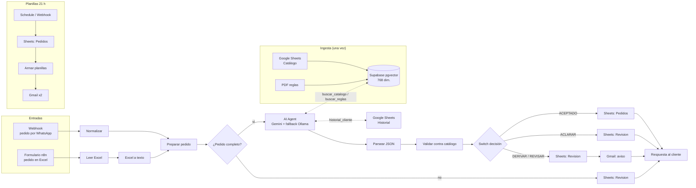

### Fuentes de entrada

1. **Webhook** (`POST /pedido-factory`): simula el mensaje de WhatsApp Business.
2. **Formulario n8n**: el responsable sube el Excel que mandó el cliente.
3. **Google Sheets**: catálogo (146 productos, sección, unidad y variantes de tamaño) e historial de pedidos por cliente, que el agente consulta como herramienta.
4. **Supabase**: base vectorial con el catálogo y las reglas (RAG).

**Ejemplo de entrada (Webhook):**

```json
{ "cliente": "Mayorista A", "texto": "buenas si\n4 pan de campo\n4 baguet\n4 ciabttaA" }
```

n8n lo recibe dentro de `body`, por eso las expresiones usan `$json.body.cliente` y `$json.body.texto`.

**Ejemplo de salida (respuesta al cliente):**

```json
{
  "id_pedido": "P261123201019",
  "decision": "ACEPTADO",
  "mensaje": "¡Gracias! Registramos tu pedido para el miércoles 25/11: 4 Pan de Campo, 4 Pan Baguette unid., 4 Pan Ciabatta."
}
```

### Por qué cada nodo está ahí

| Nodo | Motivo |
|---|---|
| Normalizar / Excel a texto | Los dos canales llegan con estructuras distintas; se unifican en `cliente`, `canal`, `texto`. |
| Preparar pedido | Genera el ID del pedido y calcula la fecha de entrega por defecto (+2 días; +1 para particulares). |
| ¿Pedido completo? (If) | No gasta una llamada a la IA en un pedido sin cliente válido o sin texto. |
| AI Agent | Interpreta texto libre y decide qué herramienta usar y qué hacer con el pedido. |
| Parsear respuesta (Code) | Valida que la IA devolvió un JSON con la estructura esperada. |
| Validar pedido (Code) | Contrasta cada producto con el catálogo oficial, controla cantidades, anticipación y tamaños por defecto. |
| Switch | Envía cada decisión a su destino real. |
| Respuesta al cliente | Devuelve el mensaje que se le enviaría al cliente por WhatsApp. |

---

## 3. Elección de modelos (local vs. nube) y del Vector Store

El sistema usa **tres modelos**, cada uno elegido por un motivo distinto:

| Paso | Modelo | Dónde corre | Por qué |
|---|---|---|---|
| Embeddings (ingesta y búsquedas) | `nomic-embed-text` (768 dim.) | **Local** (Ollama) | Se usa en cada búsqueda (3 a 10 por pedido): local no tiene costo ni límites de uso. El catálogo de la empresa no sale de la PC para vectorizarse. Es liviano (~270 MB). |
| Agente principal | Gemini `gemini-3.5-flash-lite` (temperatura 0,1) | **Nube** | Ver la explicación abajo. |
| Respaldo del agente | `qwen2.5:7b` | **Local** (Ollama) | Si Gemini no responde (errores 503 por alta demanda), el agente sigue funcionando sin depender del proveedor. |

**Por qué el agente usa un modelo en la nube.** La primera versión usaba `qwen2.5:7b` local. En las pruebas, el modelo **llamaba bien a las herramientas, pero después devolvía respuestas vacías de forma intermitente**: en los logs se veía la última llamada con ~3.400 tokens de entrada y **0 tokens de salida**. Para un proceso que corre todos los días eso no es aceptable. Gemini maneja de forma confiable el ciclo de herramientas (busca un producto, reintenta con otra variante si no lo encuentra, consulta el historial). La decisión es razonable por tres motivos:

- **Privacidad:** los pedidos contienen productos y cantidades, sin datos personales ni financieros sensibles. Los nombres de los clientes se manejan anonimizados.
- **Costo:** el volumen es bajo (unos 5 a 8 pedidos por día). Entra en la capa gratuita, y en un plan pago serían centavos por mes.
- **Independencia:** se mitiga con reintentos automáticos y con el modelo local de respaldo.

### Vector Store: Supabase (pgvector)

- **Persistencia:** a diferencia de la Simple Vector Store (en memoria), los datos no se pierden al reiniciar n8n o Docker.
- **Metadata y filtros:** cada documento tiene `tipo = catalogo` o `tipo = reglas`, y cada herramienta del agente busca solo en lo suyo.
- **Consistencia de dimensiones:** la columna es `vector(768)`, igual a la salida de `nomic-embed-text`. La ingesta y la búsqueda usan el mismo modelo.
- **Seguridad:** la tabla tiene **Row Level Security** activado. n8n accede con la clave de servicio, y la función de búsqueda `match_documents` es `security definer` (solo lectura), así que ninguna clave pública puede leer ni modificar los datos.

**Estrategia de indexación:**

- **Catálogo:** cada producto es un documento corto (`Producto | Código | Sección | Unidad | Otras variantes`), sin dividir. Así cada resultado de búsqueda es exactamente un producto.
- **Reglas:** el PDF se divide con *Recursive Character Text Splitter* (chunks de 500 caracteres con 50 de solapamiento), y quedan 13 fragmentos.

---

## 4. Por qué un AI Agent con RAG (y no un nodo de IA simple)

- **El texto es libre y está mal escrito:** "ciabttaA", "baguet", "pasteleras", "masa madre" (que según el cliente es un producto u otro). Una búsqueda exacta o una tabla de equivalencias fija no lo resuelve.
- **El conocimiento es grande y cambia:** 146 productos con variantes. No entra en un prompt, y si entrara habría que editar el prompt cada vez que cambia el catálogo. Con RAG se actualiza la planilla y se vuelve a correr la ingesta.
- **El agente decide qué herramienta usar y cuándo:**
  - `buscar_catalogo` una vez por producto, y reintenta con otro término si no lo encuentra ("pan de campo" → "campo").
  - `buscar_reglas` solo cuando falta un tamaño o no reconoce un nombre.
  - `historial_cliente` solo si a un producto con varios tamaños le falta el tamaño y el cliente no tiene tamaño por defecto.

  Un nodo de IA simple recibe siempre el mismo contexto y no puede hacer búsquedas condicionales.
- **Toma una decisión real que cambia el camino del flujo:** **ACEPTADO** (se guarda y se confirma), **ACLARAR** (se le pregunta al cliente) o **DERIVAR** (se avisa al responsable). No solo genera texto.

---

## 5. System Prompt del agente

```
## ROL
Sos el asistente de recepción de pedidos de la Factory, el centro de producción de una panadería y pastelería de Mendoza. Recibís pedidos de clientes (texto de WhatsApp o filas de un Excel) y los convertís en un pedido estructurado con productos del catálogo oficial, para armar las planillas de producción.

## HERRAMIENTAS
- buscar_catalogo: busca productos en el catálogo oficial (código, nombre, sección, unidad y otras variantes de tamaño). Usala UNA VEZ POR CADA producto del pedido, con el nombre corregido (por ejemplo "ciabttaA" → "ciabatta", "baguet" → "baguette").
- buscar_reglas: busca en las reglas de pedidos (tamaños por defecto por cliente, equivalencias de nombres, anticipación). Usala cuando un producto tenga varios tamaños y el pedido no lo indique, o cuando no sepas a qué producto se refiere un nombre.
- historial_cliente: devuelve qué productos y tamaños pidió antes este cliente. Usala SOLO si a un producto con varios tamaños le falta el tamaño y el cliente no es Café ni La Pana.

## TAREA
1. Ignorá las líneas que no son productos (saludos, títulos, totales).
2. Para cada producto, buscalo con buscar_catalogo y elegí el resultado que corresponde. Copiá el código (solo dígitos, o vacío si el producto no tiene) y el nombre EXACTOS.
3. Tamaños: SOLO importan en los productos cuyo resultado tiene "Otras variantes" distintas de "ninguna" (tortas y tartas). Panes, facturas y sándwiches tienen un solo tamaño: no preguntes. Si falta el tamaño:
   - Café → el tamaño de 10 cm; si ese producto no tiene 10 cm, el de 18 cm. Ejemplos: key lime → "Key lime 10 cm"; vasca → "Vasca de 18 cm"; havanet → "Havanet 18 cm".
   - La Pana → el tamaño de 22 cm; si no tiene 22 cm, el más grande. Ejemplos: key lime → "Key lime 24 cm"; vasca → "Vasca 24 cm"; tiramisú → "Tiramisu 22 cm".
   - Otros clientes → usá historial_cliente; si no se puede resolver, preguntá.
   Nunca uses el tamaño por defecto de un cliente para otro.
4. Fecha de entrega: la indicada por el cliente o, si no indica, la fecha por defecto.
5. Tomá UNA decisión para todo el pedido:
   - ACEPTADO: todos los productos identificados sin dudas.
   - ACLARAR: SOLO cuando el producto existe en el catálogo pero falta un dato que el cliente puede responder (tamaño, tipo o unidad). Escribí UNA pregunta concreta.
   - DERIVAR: si algún producto NO aparece en los resultados de buscar_catalogo (aunque haya algo parecido), si el pedido menciona alergias, "sin gluten" o "sin TACC" en un producto que no lo dice en su nombre, una cantidad supera el triple de lo habitual, no se cumple la anticipación, es un reclamo/cancelación/modificación, pide precios, o el mensaje no es un pedido.

## REGLAS
- Usá solo productos que devuelva buscar_catalogo. Nunca inventes productos ni códigos. Algunos productos del catálogo no tienen código ("Código: " vacío): siguen siendo válidos; en ese caso dejá codigo vacío y copiá el nombre exacto del producto.
- Cantidades en la unidad del catálogo; no conviertas unidades.
- Indicaciones como "rebanado" o "en paquetes" van en observacion.
- Si usaste el tamaño por defecto del cliente, observacion = "tamaño por defecto del cliente"; si usaste el historial, "tamaño según historial". En los demás casos, observacion vacía.
- Ante la duda entre ACEPTADO y ACLARAR, elegí ACLARAR. Ante un producto que no existe, siempre DERIVAR (nunca ACLARAR).

## LÍMITES (qué NO hacer)
- NO confirmes precios, descuentos ni horarios de entrega.
- NO modifiques ni canceles pedidos anteriores: eso se DERIVA.
- NO aceptes productos fuera del catálogo aunque se parezcan.
- NO respondas temas ajenos a pedidos.

## FORMATO DE SALIDA
Respondé ÚNICAMENTE con un objeto JSON válido, sin texto antes ni después y sin bloques de código. Estructura exacta:
{"decision":"ACEPTADO|ACLARAR|DERIVAR","fecha_entrega":"AAAA-MM-DD","items":[{"texto_original":"","codigo":"","producto":"","seccion":"","cantidad":0,"unidad":"","observacion":""}],"pregunta_cliente":"","motivo":"","mensaje_cliente":""}
El campo mensaje_cliente es breve, cordial, en español rioplatense y sin emojis:
- ACEPTADO: confirmación con el resumen de productos y la fecha de entrega.
- ACLARAR: la pregunta concreta.
- DERIVAR: exactamente "Recibimos tu mensaje, en breve te responde alguien del equipo."
Tu respuesta final debe ser SIEMPRE este JSON.
```

**Mensaje de usuario que recibe el agente:**

```
Cliente: {{ $json.cliente }}
Canal: {{ $json.canal }}
Fecha de recepción: {{ $json.fecha_recepcion }}
Fecha de entrega por defecto: {{ $json.fecha_entrega_default }}
Fecha de entrega indicada por el cliente: {{ $json.fecha_indicada || 'no indicada' }}
Pedido:
{{ $json.texto }}
```

---

## 6. Manejo de errores y casos límite

| # | Punto de falla | Qué puede pasar | Cómo se gestiona |
|---|---|---|---|
| 1 | **Entrada** | Pedido sin cliente válido o sin texto. | If **¿Pedido completo?** antes del agente: va directo a la hoja *Revision* sin gastar una llamada a la IA. |
| 2 | **Proveedor de IA** | Gemini responde 503 (alta demanda) o no responde. | **Retry On Fail** (3 intentos, 5 s) y **modelo de respaldo local** (Ollama `qwen2.5:7b`). |
| 3 | **Respuesta del LLM** | Respuesta vacía, JSON roto (por ejemplo, un salto de línea en medio de una fecha) o estructura incompleta. | Code **Parsear respuesta**: limpia y valida el JSON. Si falla, la decisión pasa a **REVISAR**, se guarda en *Revision* y se avisa por mail. El pedido nunca se pierde ni se escribe con datos rotos. |
| 4 | **Interpretación del agente** | El agente inventa un código, usa un tamaño equivocado o acepta un pedido fuera de plazo. | Code **Validar pedido**: cada producto se contrasta con el catálogo oficial (código o nombre), se controlan cantidades y anticipación mínima, y se **corrige el tamaño por defecto** de Café y La Pana con una regla fija. Las correcciones quedan registradas en `correcciones_validador`. |
| 5 | **Casos fuera de alcance** | Reclamos, productos que no existen, pedidos "sin gluten". | Límites explícitos en el system prompt: **DERIVAR**, con mensaje neutro al cliente y aviso por mail al responsable. |
| 6 | **Fallas de infraestructura** | Credencial de Google vencida, Supabase sin responder, Ollama cerrado. | Workflow **Alertas de errores** con **Error Trigger**, asignado como *Error Workflow* de la recepción y de las planillas: manda un mail con el workflow, el nodo y el error. |

**Problemas reales encontrados durante el desarrollo:**

- **Modelo local poco confiable con herramientas:** respuestas vacías intermitentes. Por eso se pasó a Gemini con respaldo local.
- **Búsqueda vectorial sin resultados desde n8n, aunque funcionaba en SQL.** La metadata se había guardado como `Tipo` (con mayúscula), y además RLS ocultaba las filas sin dar error. Se resolvió con la clave en minúscula y la función de búsqueda con `security definer`.
- **Ingesta duplicada** (305 filas en lugar de 159). Se vació la tabla y se recargó una sola vez.
- **La metadata de las reglas se cargó como `Reglas` (con mayúscula)** y el filtro `tipo = reglas` no las encontraba. Se corrigió en la base con un `UPDATE` y en el Data Loader de la ingesta.
- **La credencial OAuth de Google vence cada 7 días** con la app en modo *Testing*. Se publicó la app de Google Cloud.

---

## 7. Pruebas

| # | Pedido | Esperado | Resultado |
|---|---|---|---|
| 1 | Mayorista A: "4 pan de campo / 4 baguet / 4 ciabttaA" | Interpretar errores de tipeo | ✅ ACEPTADO: Pan de Campo, Pan Baguette, Pan Ciabatta |
| 2 | Mayorista B: "3 key lime y 2 brownie" | Resolver el tamaño con el historial | ✅ ACEPTADO: Key lime 10 cm ("tamaño según historial") |
| 3 | Mayorista A: "2 vasca y 4 pan de campo" (sin historial de vasca) | Preguntar el tamaño | ✅ ACLARAR: "¿De qué tamaño querés la vasca (mono porción, 18 cm o 24 cm)?" |
| 4 | Café: "3 key lime / 2 vasca / 10 medialunas" | Tamaño por defecto del Café | ✅ ACEPTADO: Key lime 10 cm, Vasca de 18 cm, Medialunas |
| 5 | La Pana: "6 pan de molde sin gluten y 10 ciabatta" | Producto inexistente + sin gluten | ✅ DERIVAR + mail |
| 6 | Mayorista B: "Ayer llegaron 2 tortas rotas" | Reclamo | ✅ DERIVAR + mail |
| 7 | "Cliente X": "4 pan de campo" | Cliente inválido | ✅ Frenado por el If, a *Revision* |
| 8 | Excel del Café (formulario) | Leer Excel y cargar el pedido | ✅ ACEPTADO, 4 productos en *Pedidos* |
| 9 | Mayorista A: "2 tiramisu y 4 baguette" → luego "de 22 cm" | Memoria de la conversación | ✅ ACLARAR y después ACEPTADO: 2 Tiramisu 22 cm + 4 Pan Baguette |
| 10 | Planilla a demanda del 25/11 | Armar planillas por sección | ✅ Panadería: 7 productos · Pastelería: 3 productos, 2 mails |

---

## 8. Capturas

**Ingesta (catálogo y reglas hacia Supabase)**

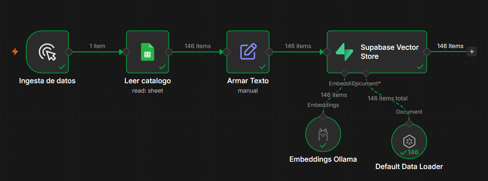
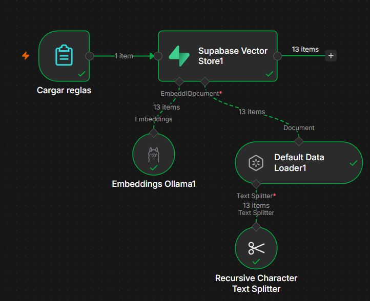

**Base vectorial en Supabase:** 159 documentos con su embedding (146 del catálogo y 13 de reglas).

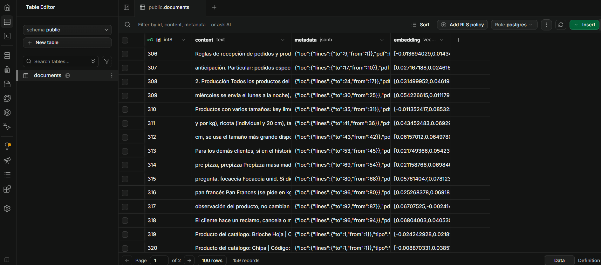
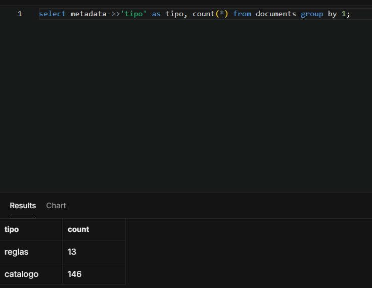

**Flujo de recepción** (ejecución de un pedido aceptado)

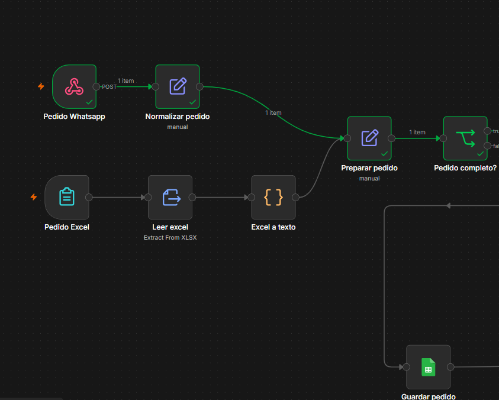
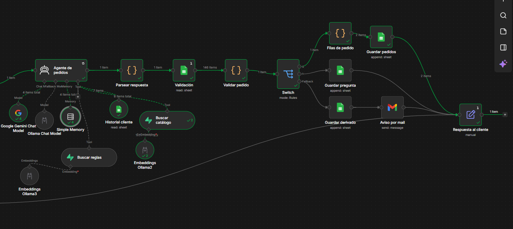

**Agente con sus modelos y herramientas.** El agente llamó a `buscar_catalogo` y a `historial_cliente`, y usó la memoria.

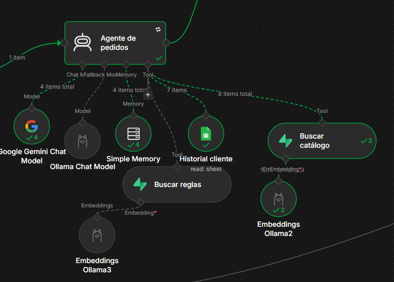
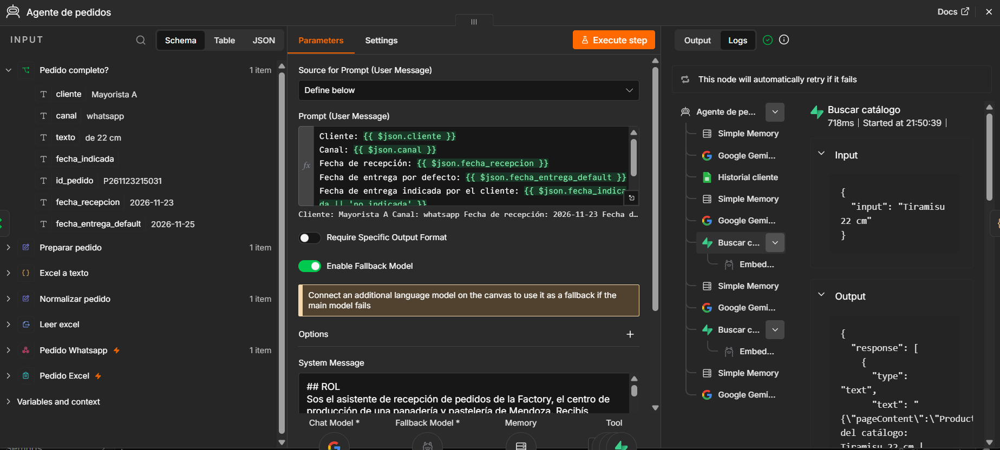

**Pruebas por WhatsApp (Webhook)**

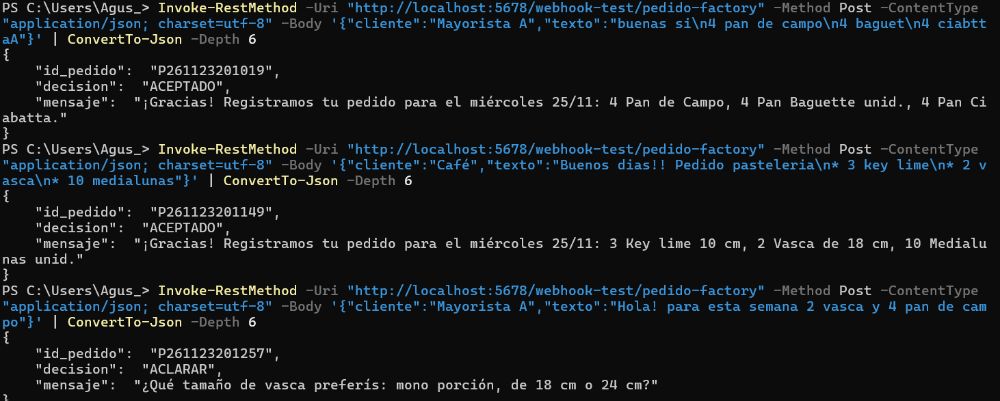
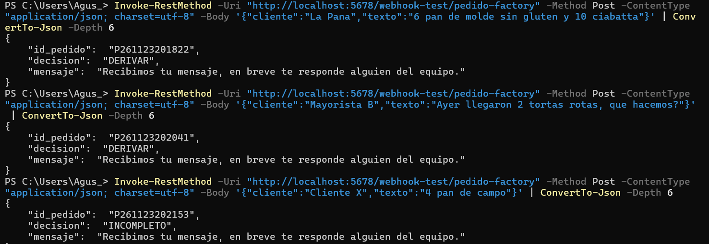

**Prueba de memoria:** el cliente responde "de 22 cm" y el agente completa el pedido anterior.

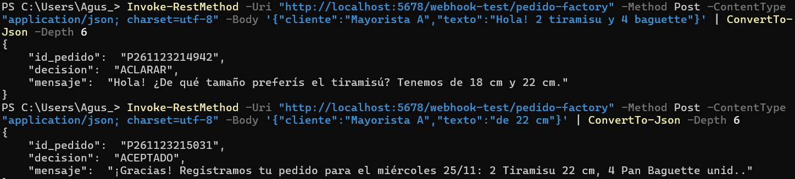
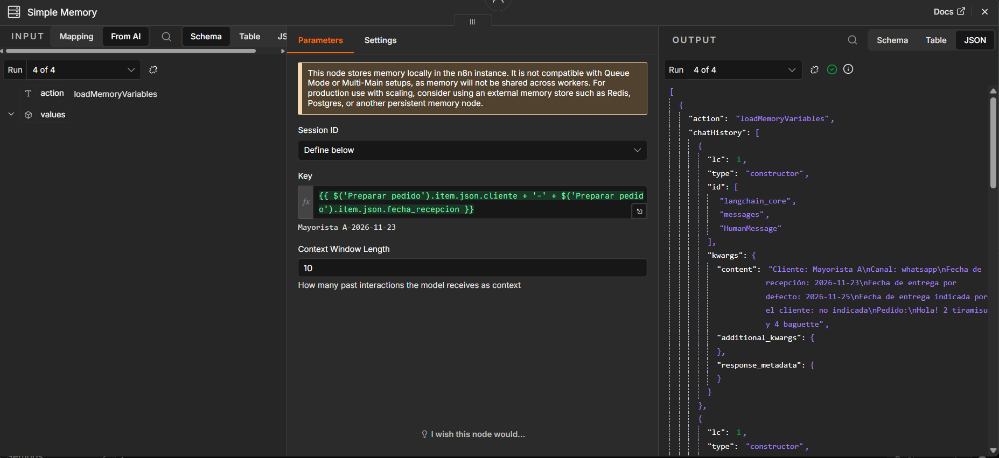

**Salidas en Google Sheets y Gmail**

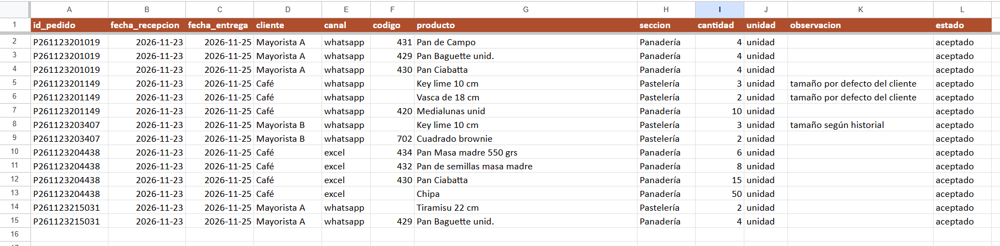
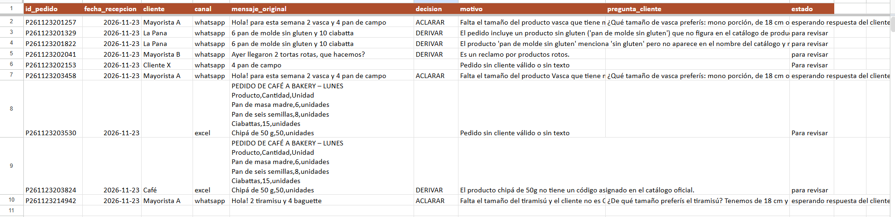
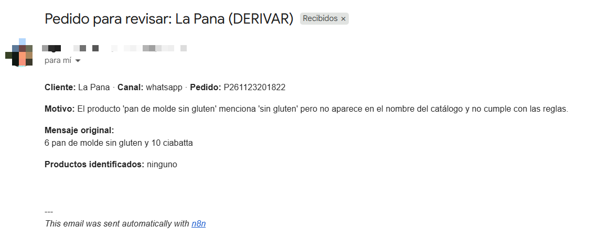

**Planillas de producción (21 h o a demanda)**

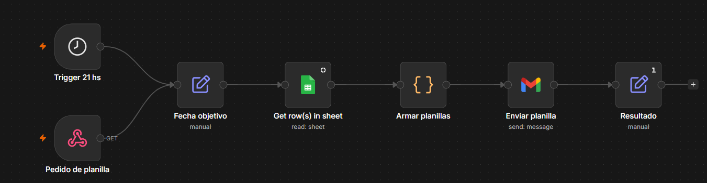
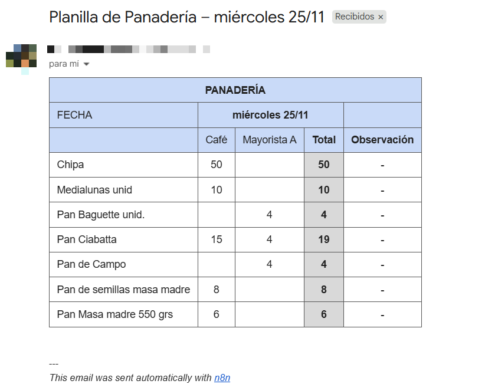
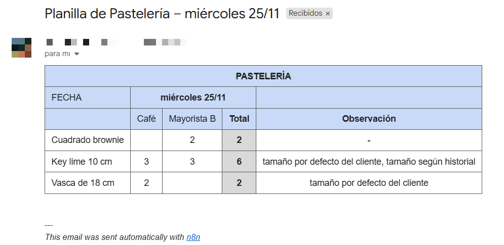

**Alertas de errores**

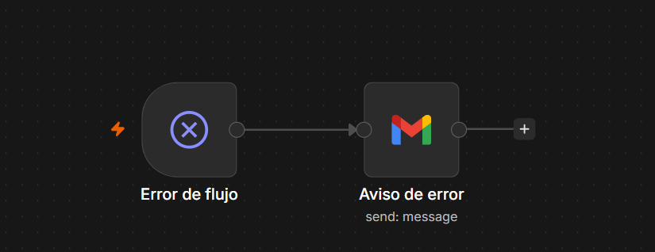

---

## 9. Cómo ejecutarlo

1. **n8n** en Docker (`docker.n8n.io/n8nio/n8n`) y **Ollama** con `nomic-embed-text` y `qwen2.5:7b`.
2. **Supabase:** correr `supabase/setup.sql` (tabla `documents` con `vector(768)`, función `match_documents`, RLS y permisos).
3. **Google Sheets:** importar `datos/Factory_Pedidos_n8n.xlsx` (pestañas Catalogo, Historial, Clientes, Pedidos y Revision).
4. **Credenciales en n8n:** Supabase API, Google Sheets OAuth2, Gmail OAuth2, Google Gemini y Ollama (desde Docker: `http://host.docker.internal:11434`).
5. **Importar los 4 workflows** de `workflows/` y asignar **Alertas de errores** como *Error Workflow* en Recepción y Planillas.
6. **Ejecutar una vez la Ingesta:** el flujo del catálogo y el formulario con `datos/Reglas_pedidos_Factory.pdf`.
7. **Probar un pedido:**

```powershell
Invoke-RestMethod -Uri "http://localhost:5678/webhook-test/pedido-factory" -Method Post -ContentType "application/json; charset=utf-8" -Body '{"cliente":"Mayorista A","texto":"4 pan de campo\n4 baguet"}'
```

---

## 10. Próximos pasos

- Conectar la **API real de WhatsApp Business** e identificar al cliente por su número de teléfono.
- Reemplazar la Simple Memory por una **memoria en Postgres** (Supabase), para que las aclaraciones sobrevivan a reinicios.
- Pasar n8n a un **servidor o a la nube**, para que las planillas de las 21 h no dependan de una PC prendida.
- Medir **latencia, tasa de derivación y costo por pedido** durante un mes para ajustar las reglas.
